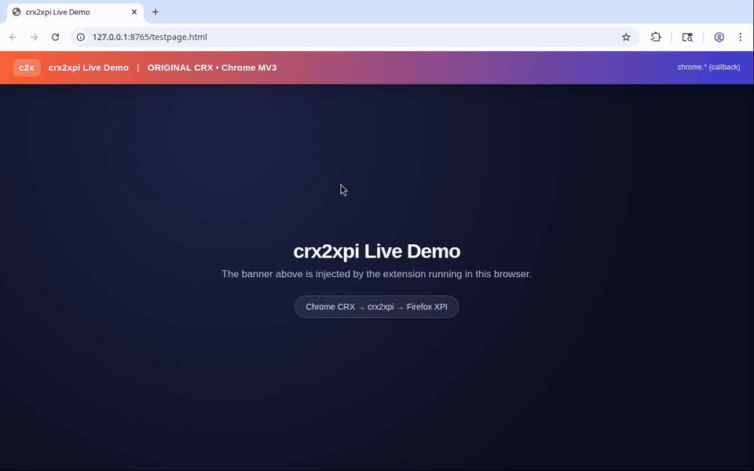
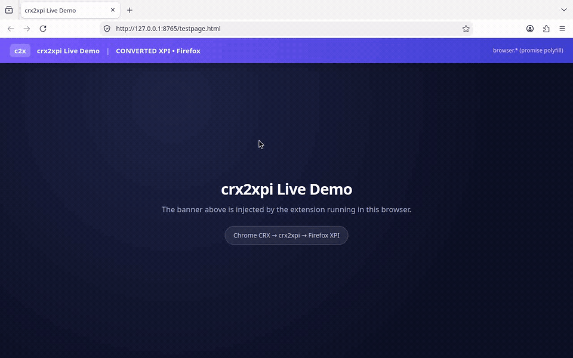

# crx2xpi

English | [中文](README.zh.md)

[](https://www.npmjs.com/package/crx2xpi) [](https://github.com/url9/crx2xpi/actions/workflows/ci.yml) [](LICENSE) [](./package.json) [](./tsconfig.json)

> Convert Chrome MV3 extensions (CRX3) into Firefox / GeckoView-compatible XPI add-ons.

## What it does

`crx2xpi` is a community-maintained bridge between the Chromium WebExtension
runtime and Gecko. It strips the CRX3 signing header, rewrites manifest fields
for Gecko (the MV3 `service_worker` downgrade, permission/WAR/CSP normalisation,
removal of Chrome-only keys, and a stable add-on id — see
[Install the generated XPI](#install-the-generated-xpi)), injects compatibility
shims, optionally emits a static compatibility report, and packages a
signing-ready XPI.

The engine and CLI work end to end: CRX3 unpacking, manifest rewrites, shim
injection, compatibility diagnostics, and XPI repacking are covered by unit,
integration (real CRX3 sample), and CLI tests. Six converted extensions have
been verified functionally in a real Firefox browser, and the diagnostic
catalogue was checked against ten real-world samples with zero false positives.
Detection coverage was expanded from genuine false negatives, including a
real add-on that installed and reported clean but could not be used —
see [verified compatibility findings](./docs/verified-compat-findings.md).

Every packaged XPI ships two compatibility assets, always evaluated first in
`background.scripts`:

1. `chrome-promise-shim.js` — Firefox keeps the `chrome` namespace
   callback-only, while Chrome MV3 code calls `await chrome.*`. On Firefox the
   shim aliases `chrome` to the promise-capable `browser` namespace, restoring
   Chromium calling semantics without touching the original extension code.
   Without it, converted extensions load and report no errors but their
   promise-style API calls silently resolve to `undefined`.
2. [`webextension-polyfill`](https://github.com/mozilla/webextension-polyfill)
   (MPL-2.0, see [NOTICE](./NOTICE)) — Mozilla's official polyfill for code
   that references the promise-based `browser.*` API; a no-op where `browser`
   already exists natively.

This was verified end-to-end: the open-source CookieMop extension, converted
by `crx2xpi`, deletes its cookies for real when a tab closes in Firefox
(including HttpOnly cookies), which requires the promise shim to be in place.

## CLI usage

Run without installing via `npx`, or install from npm:

```bash
# Run with npx — no installation needed (Node.js >= 20 required)
npx crx2xpi my-extension.crx my-extension.xpi

# Verbose mode prints every conversion stage
npx crx2xpi --verbose my-extension.crx my-extension.xpi

# Keep the extracted payload directory on disk for debugging
npx crx2xpi --keep-temp my-extension.crx my-extension.xpi

# Also write a static compatibility report (Markdown)
npx crx2xpi --report report.md my-extension.crx my-extension.xpi
```

Install from npm:

```bash
# Global install adds the crx2xpi command to your PATH
npm install -g crx2xpi
crx2xpi my-extension.crx my-extension.xpi

# Or use the conversion engine as a library
npm install crx2xpi
```

```js
import { convertCrxToXpi } from 'crx2xpi/dist/core/converter.js';
```

From a repository checkout, run the built binary directly:

```bash
pnpm build
node dist/cli.js --verbose sample.crx out/sample.xpi
```

Options:

| Option | Short | Description |
| --- | --- | --- |
| `<input.crx>` | — | Source Chrome CRX3 extension file. |
| `<output.xpi>` | — | Destination Firefox XPI add-on file (parent directories are created). |
| `--verbose` | `-v` | Print detailed progress: header validation, manifest parsing, rewrites, repacking. |
| `--keep-temp` | `-k` | Keep the extracted payload directory for debugging; its path is printed on success. |
| `--report <path>` | `-r` | Write a static compatibility Markdown report listing Chrome-only API usage and `importScripts()` calls that need manual review. |
| `--id <id>` | `-i` | Custom Gecko add-on ID when the source manifest has none (email form, ASCII only, e.g. `my-ext@domain.com`); see [Install the generated XPI](#install-the-generated-xpi). |

Example session with `--verbose`:


The CLI exits with code `0` on success and `1` on usage or conversion errors.

## Manifest rewrites for Gecko

Beyond the background downgrade, the converter applies a small, idempotent set
of manifest rewrites that close well-understood Chrome/Gecko gaps:

| Rewrite | Why |
| --- | --- |
| Stable `browser_specific_settings.gecko.id` | A side-loaded add-on without a fixed id gets a new random id on every load, breaking id-scoped storage and settings. An existing id is never overwritten; see [Install the generated XPI](#install-the-generated-xpi). |
| Host patterns moved from `permissions` to `host_permissions` | Firefox MV3 treats host patterns in `permissions` as unknown API permissions and denies the host access. |
| Chrome-only keys removed (`key`, `update_url`, `minimum_chrome_version`, `oauth2`, `export`) | `update_url` in particular can make some Firefox builds attempt a Chrome Web Store update. |
| MV3 `browser_action` renamed to `action` | `action` is the standard MV3 key. |
| `use_dynamic_url` stripped from `web_accessible_resources` | Firefox does not implement dynamic-URL ids; the flag can invalidate the resource declaration. |
| String CSP normalised to the MV3 object form | A bare CSP string is MV2 syntax that Firefox MV3 rejects. |

The rewrites are intentionally conservative. In particular `crx2xpi` does **not**
force `content_scripts[].all_frames`, add `'wasm-unsafe-eval'` to CSP, drop
`background.type` (needed for module workers), or inject a fixed bundle of
runtime shims that could shadow native Firefox APIs. Those changes either alter
behaviour or widen the security policy, so they are left to the developer.

## Static compatibility report

`--report <path>` runs a read-only analysis of the source CRX and writes a
Markdown report. It flags Chrome-only API usage (`offscreen`, `sidePanel`,
`tabGroups`, `declarativeContent`, and others) with the exact file and line, plus
`importScripts()` calls that may need manual review. Findings are graded
`warning` or `info` and include a suggested action.

The report never rewrites source code or injects shims, and it explicitly notes
that static analysis cannot prove runtime correctness — always validate the
converted XPI in a real Firefox browser.

## Install the generated XPI

> On desktop Release and Beta, extensions not signed by Mozilla cannot be
> installed. On Android, the "install from file" menu accepts unsigned
> packages, so AMO signing is only required for official distribution or
> installation on desktop Release. Choose the method that fits your scenario
> below:
>
> **Extension ID**: except for `about:debugging` temporary loading, every
> installation method (Android install-from-file, AMO signing) requires an
> extension ID in the XPI's `manifest.json`
> (`browser_specific_settings.gecko.id`). Without a fixed id, a side-loaded
> add-on gets a new random id on each load, silently breaking id-scoped storage
> and settings. `crx2xpi` never overwrites an id from the source manifest; when
> there is none, it generates a stable email-style id hashed from the extension
> name (for example `my-extension@crx2xpi.local`), which stays the same when the
> same extension is converted again. Use `--id` to choose your own, or replace
> the generated id before signing for AMO submission.

### Scenario 1: Desktop testing (Firefox Developer Edition / Nightly / ESR)

The signature-enforcement override only works in those three channels.
Release and Beta ignore this preference by policy, so toggling it has no effect.

1. Open Firefox, type `about:config` in the address bar, press Enter, and
   accept the risk notice.
2. Search for `xpinstall.signatures.required` and double-click to set its value
   to `false`.
3. Type `about:debugging` in the address bar.
4. Click **This Firefox** on the left, then **Load Temporary Add-on...**, and
   select your converted `.xpi` file (or an extracted `manifest.json`).
   Temporarily loaded add-ons are removed when Firefox restarts.

### Scenario 2: Mobile testing (Firefox for Android, all channels)

Firefox for Android has no `about:config`, so the desktop signing-override path
does not exist; a hidden menu takes its place. Since Firefox 122 (January 2024)
this works in the release channel too (requires Android 10 or later):

1. Open Firefox and go to **Settings** → **About Firefox**.
2. Tap the Firefox logo five times in quick succession to unlock the hidden
   menu.
3. Go back to Settings; a new **Install Extension from File** entry now
   appears.
4. Select the `.xpi` file you saved locally to install it.

### Scenario 3: Permanent installation (desktop and mobile)

AMO signing is the only official path for permanent installation in Release and
Beta. On desktop Release specifically, it is the only path — the signing
override does not work there and temporary loads do not survive a restart. Two
channels are available when submitting:

- **unlisted** (self-distributed, not published on AMO): automated review only,
  usually signed within seconds to minutes — ideal for private distribution
  and the choice for most testing scenarios.
- **listed** (publicly published): requires human review before appearing
  publicly, intended for production releases.

Steps:

1. Visit the [Mozilla Add-ons (AMO)](https://addons.mozilla.org/developers/)
   developer center and sign in.
2. Choose **Submit a New Add-on** and upload your converted `.xpi` file
   (select the unlisted option for private distribution).
3. Mozilla signs the submission (unlisted is usually fast; automated review
   can take up to 24 hours, and some submissions are escalated to manual
   review).
4. Download the signed `.xpi`; it can now be installed directly in any
   official release version of Firefox.

### Installation channel quick reference

| Method | Desktop Release | Desktop Beta | Desktop Dev / Nightly / ESR | Android (all channels) | GeckoView-hosted browsers |
| --- | :-: | :-: | :-: | :-: | :-: |
| AMO signing (listed / unlisted) | ✅ | ✅ | ✅ | ✅ | N/A (not needed) |
| Disable signing `xpinstall.signatures.required=false` | ❌ ignored | ❌ ignored | ✅ | ❌ no `about:config` | N/A (not enforced) |
| `about:debugging` temporary load | ❌ | ❌ | ✅ | ❌ | N/A (host-dependent) |
| 5-tap "Install Extension from File" | N/A | N/A | N/A | ✅ (Firefox 122+, Android 10+) | N/A (host-dependent) |
| Host loads the XPI file directly | ❌ | ❌ | ❌ | ❌ | ✅ |

In this table: ✅ = supported, ❌ = blocked or ineffective, N/A = not applicable.

Rule of thumb: **on desktop, check the channel (the override only exists in
Dev / Nightly / ESR); on mobile, count the taps (there is no config editor);
in an embedded engine, check the host** — signature enforcement is a Firefox
distribution policy, not a Gecko engine policy. Third-party browser shells
built on GeckoView are not bound by Mozilla's signing requirement and can load
converted packages directly.

---

## Test samples

The automated integration suite ships one self-generated MV3 fixture,
`tests/fixtures/sample-mv3 (crx2xpi).crx` — the only extension binary in this
repository. For manual testing against production-shaped extensions, fetch a
CRX yourself from the official sources below; their binaries are **not**
redistributed here.

These candidates are open source, work locally without an account or server,
and are MIT licensed. Except for Dark Reader — which ships its own Firefox
port, so the GIF above converts its official Chrome MV3 build purely to prove
the pipeline against a large, well-known codebase — they have no official
Firefox listing on Mozilla Add-ons at the time of writing, which is exactly
where a CRX-to-XPI conversion is useful.

| Extension | Developer | Chrome Web Store | Source | Store ID |
| --- | --- | --- | --- | --- |
| Dark Reader | Alexander Shutau | [Store](https://chromewebstore.google.com/detail/dark-reader/eimadpbcbfnmbkopoojfekhnkhdbieeh) | [GitHub](https://github.com/darkreader/darkreader) | `eimadpbcbfnmbkopoojfekhnkhdbieeh` |
| CookieMop | thoopring | [Store](https://chromewebstore.google.com/detail/cookiemop/nbehnialaodjcffgjkckbnocggbdmdel) | [GitHub](https://github.com/thoopring/cookiemop) | `nbehnialaodjcffgjkckbnocggbdmdel` |
| Cursorfly | anugotta | [Store](https://chromewebstore.google.com/detail/cursorfly-screen-recorder/dediffcenkdgplheoefilljjpcmjgidp) | [GitHub](https://github.com/anugotta/cursorfly-screen-recorder) | `dediffcenkdgplheoefilljjpcmjgidp` |
| Alt Text Auto-Fill | SoftwareforProgress | [Store](https://chromewebstore.google.com/detail/alt-text-auto-fill/ldgghfoheoipmffiidhcgjgnhmjnmkpc) | [GitHub](https://github.com/SoftwareforProgress/Alt-Text-Auto-Fill) | `ldgghfoheoipmffiidhcgjgnhmjnmkpc` |
| Open Stay Focused | xingwudao | [Store](https://chromewebstore.google.com/detail/open-stay-focused/pmfcncldogcmehkdmoekagmlgcjcgpem) | [GitHub](https://github.com/xingwudao/open-stay-focused) | `pmfcncldogcmehkdmoekagmlgcjcgpem` |
| Local iTab | 21888 | [Store](https://chromewebstore.google.com/detail/local-itab/hgcpfeedmndipealdcejckphlaicgjma) | [GitHub](https://github.com/21888/chrome-local-itab) | `hgcpfeedmndipealdcejckphlaicgjma` |

The Chrome Web Store URL also serves as a CRX download source: open the store
page, or use the extension ID with `clients2.google.com` to fetch the package.
Then convert it like any other:

```bash
npx crx2xpi downloaded.crx downloaded.xpi
```

The Store ID can serve as a convenient base when choosing your own Gecko ID
(see [Install the generated XPI](#install-the-generated-xpi)). "No Firefox
version" means there is no official Mozilla Add-ons entry;
third-party conversions or unrelated same-name add-ons may still exist. These
extensions belong to their respective developers; `crx2xpi` is not affiliated
with them, and these links are provided for testing only.

### See it in action

A widely used third-party extension — [Dark Reader](https://github.com/darkreader/darkreader),
the open-source dark-mode add-on used by millions — running its actual popup
UI in both browsers. Left: the original Chrome MV3 CRX, using the
callback-based `chrome.*` API and a service worker. Right: the same official
Chrome MV3 build after `crx2xpi` conversion, running in Firefox as
non-persistent `background.scripts` via the injected chrome alias shim and
Mozilla's `browser.*` promise polyfill. Both windows show the same demo page
next to the extension popup; toggling Dark mode in the popup re-themes the
page live in both browsers — the popup and its logic are Dark Reader's
unmodified source.

<p align="center">
  
  
</p>

<p align="center"><sub>Before: original Dark Reader MV3 CRX in Chrome · After: crx2xpi-converted XPI in Firefox</sub></p>

## Contributing

Prerequisites, development workflow, commit convention, project rules, and the
Code of Conduct live in [CONTRIBUTING.md](./CONTRIBUTING.md). Contributions and
bug reports are welcome.

## License

Apache-2.0 — see [LICENSE](./LICENSE) and [NOTICE](./NOTICE).
