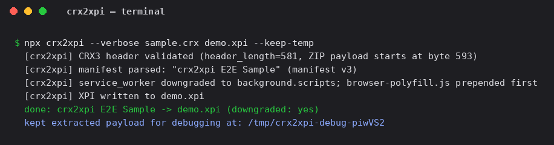

# crx2xpi

> Convert Chrome MV3 extensions (CRX3) into Firefox / GeckoView-compatible XPI add-ons.

`crx2xpi` aims to become an industrial-grade, community-maintained bridge
between the Chromium WebExtension runtime and Gecko. It strips the CRX3 signing
header, rewrites MV3-specific manifest fields (notably the `service_worker`
downgrade), and injects the `webextension-polyfill` before packaging a signed-ready
XPI.

> **Status:** the conversion engine and CLI are working end to end. CRX3
> unpacking, the MV3 `service_worker` downgrade, polyfill injection, and XPI
> repacking are implemented and covered by unit, integration (real CRX3
> sample), and CLI tests. See [CONTRIBUTING.md](./CONTRIBUTING.md) to help
> improve it.

## CLI usage

Install globally, run with `npx`, or use it directly from a checkout:

```bash
# After installing from npm (once published) or via a global install
npx crx2xpi my-extension.crx my-extension.xpi

# Verbose mode prints every conversion stage
npx crx2xpi --verbose my-extension.crx my-extension.xpi

# Keep the extracted payload directory on disk for debugging
npx crx2xpi --keep-temp my-extension.crx my-extension.xpi
```

From a repository checkout, run the built binary directly:

```bash
pnpm build
node dist/cli.js --verbose sample.crx out/sample.xpi
```

Options:

| Option | Short | Description |
| --- | --- | --- |
| `<input.crx>` | — | Source Chrome CRX3 extension file. |
| `<output.xpi>` | — | Destination Firefox XPI add-on file (parent directories are created). |
| `--verbose` | `-v` | Print detailed progress: header validation, manifest parsing, polyfill injection, repacking. |
| `--keep-temp` | `-k` | Keep the extracted payload directory for debugging; its path is printed on success. |

Example session with `--verbose`:



The CLI exits with code `0` on success and `1` on usage or conversion errors.
Bundled polyfill: the packaged XPI ships Mozilla's official
[`webextension-polyfill`](https://github.com/mozilla/webextension-polyfill)
(MPL-2.0, see [NOTICE](./NOTICE)); the injected entry is always evaluated
first in `background.scripts`.

## License

Apache-2.0 — see [LICENSE](./LICENSE) and [NOTICE](./NOTICE).

## Prerequisites

- Node.js **>= 20**
- pnpm **>= 9** (`corepack enable && corepack prepare pnpm@9 --activate`)

## Getting started

```bash
pnpm install
pnpm test          # unit tests (Vitest)
pnpm lint          # ESLint static analysis
pnpm typecheck     # TypeScript strict check
pnpm format:check  # Prettier formatting check
pnpm build         # compile to dist/
```

## Commit convention (Conventional Commits)

Every commit is validated by `commitlint` through a Husky `commit-msg` hook.
Allowed prefixes: `feat:`, `fix:`, `docs:`, `refactor:`, `test:`, `chore:`,
`build:`, `ci:`, `perf:`, `style:`, `revert:`.

```text
feat: implement CRX3 header parsing
fix: preserve background scripts when service_worker is absent
docs: document the manifest rewrite pipeline
```

You may write messages by hand or use the interactive Commitizen prompt, which
walks you through selecting the type, scope, and subject:

```bash
pnpm commit       # alias for `cz`
```

Commitizen is configured in `package.json` under `config.commitizen` with the
`cz-conventional-changelog` adapter, so the generated messages automatically
satisfy commitlint.

The repository's original `Initial commit` is preserved as-is; all subsequent
commits follow the convention above.

## Project rules

Engineering, documentation, and review rules for AI assistants and contributors
live in [`.codebuddy/rules`](./.codebuddy/rules) and
[`.codebuddy/CODEBUDDY.md`](./.codebuddy/CODEBUDDY.md). These rules cover JSDoc
requirements, comment philosophy, the CRX3 magic-byte layout, the
`service_worker` downgrade rationale, and polyfill injection order.

## Code of Conduct

Participation is governed by the [Contributor Covenant](./CODE_OF_CONDUCT.md).
