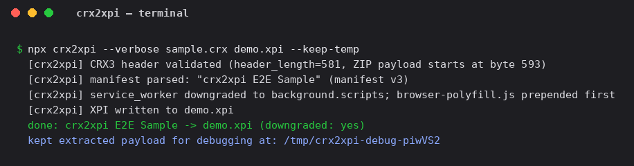
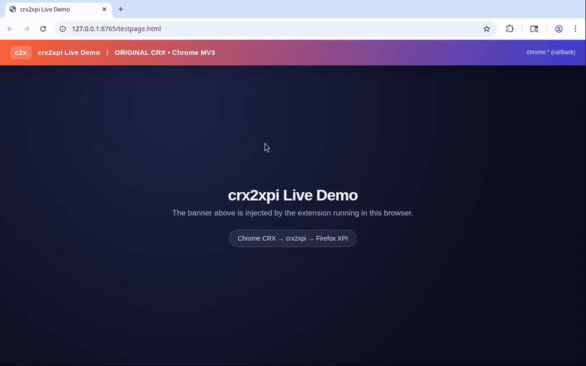
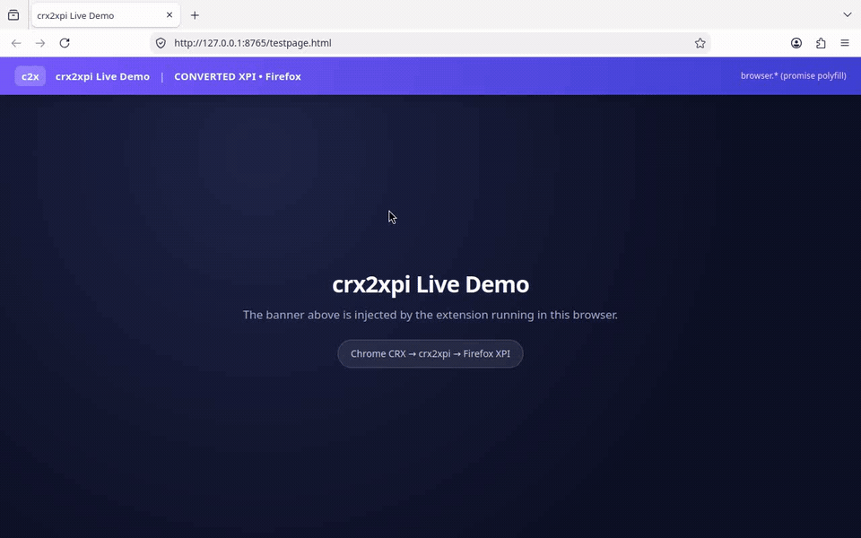

# crx2xpi

[English](README.md) | 中文

[](https://www.npmjs.com/package/crx2xpi) [](https://github.com/url9/crx2xpi/actions/workflows/ci.yml) [](LICENSE) [](./package.json) [](./tsconfig.json)

> 将 Chrome MV3 扩展（CRX3）转换为 Firefox / GeckoView 可用的 XPI 附加组件。

`crx2xpi` 是一座连接 Chromium WebExtension 运行时与 Gecko 的社区维护桥梁：把 Chrome MV3 扩展（CRX3）转换为 Firefox / GeckoView 可用的 XPI 附加组件。它会剥离 CRX3 签名头、重写 MV3 特有的 manifest 字段（尤其是 `service_worker` 降级），并注入 `webextension-polyfill`，最后打包为可直接签名的 XPI。

> **状态：** 转换引擎和 CLI 已端到端可用。CRX3 解包、MV3 `service_worker` 降级、polyfill 注入和 XPI 重打包均已实现，并有单元测试、集成测试（真实 CRX3 样本）和 CLI 测试覆盖。欢迎通过 [CONTRIBUTING.md](./CONTRIBUTING.zh.md) 参与改进。

## CLI 使用说明

用 `npx` 免安装运行，或从 npm 安装：

```bash
# npx 免安装运行（需要 Node.js >= 20）
npx crx2xpi my-extension.crx my-extension.xpi

# 详细模式：打印每个转换阶段
npx crx2xpi --verbose my-extension.crx my-extension.xpi

# 保留解压后的临时目录以便调试
npx crx2xpi --keep-temp my-extension.crx my-extension.xpi
```

从 npm 安装：

```bash
# 全局安装后可直接使用 crx2xpi 命令
npm install -g crx2xpi
crx2xpi my-extension.crx my-extension.xpi

# 或将转换引擎作为库引入
npm install crx2xpi
```

```js
import { convertCrxToXpi } from 'crx2xpi/dist/core/converter.js';
```

从仓库源码运行已构建的二进制：

```bash
pnpm build
node dist/cli.js --verbose sample.crx out/sample.xpi
```

选项：

| 选项 | 简写 | 说明 |
| --- | --- | --- |
| `<input.crx>` | — | 源 Chrome CRX3 扩展文件。 |
| `<output.xpi>` | — | 目标 Firefox XPI 附加组件文件（父目录会自动创建）。 |
| `--verbose` | `-v` | 打印详细进度：头校验、manifest 解析、polyfill 注入、重打包。 |
| `--keep-temp` | `-k` | 保留解压后的载荷目录以便调试；成功时会打印其路径。 |

`--verbose` 的运行示例：



CLI 成功时退出码为 `0`，用法或转换错误时为 `1`。
内置兼容资产：打包的 XPI 携带两个条目，始终在 `background.scripts` 中最先求值：

1. `chrome-promise-shim.js` —— Firefox 的 `chrome` 命名空间只支持回调风格，而 Chrome MV3 源码使用 `await chrome.*` 的 Promise 风格。该 shim 在 Firefox 上把 `chrome` 别名到支持 Promise 的 `browser` 命名空间，无需改动原扩展代码即可恢复 Chromium 的调用语义。没有它，转换后的扩展能加载、无报错，但所有 Promise 风格的 API 调用会静默返回 `undefined`。
2. [`webextension-polyfill`](https://github.com/mozilla/webextension-polyfill)（MPL-2.0，见 [NOTICE](./NOTICE)）—— Mozilla 官方 polyfill，供引用 `browser.*` Promise API 的代码使用；在原生已有 `browser` 的环境下是空操作。

上述行为已通过端到端实测验证：开源扩展 CookieMop 经 `crx2xpi` 转换后，在 Firefox 中关闭标签页时会真实删除对应 Cookie（包括 HttpOnly Cookie），而这依赖 Promise shim 的存在。

## 如何安装生成的 XPI

> 在桌面端 Release 和 Beta 中，未经 Mozilla 签名的扩展无法安装。而在 Android 上，「从文件安装」菜单接受未签名的包，因此只有在官方分发或桌面 Release 上安装时才必须进行 AMO 签名。请根据使用场景选择以下方式：
>
> **前提**：除 `about:debugging` 临时载入外，所有安装方式（Android 从文件安装、AMO 签名）都要求 XPI 的 `manifest.json` 中包含扩展 ID（`browser_specific_settings.gecko.id`）。若源扩展未声明该字段，请在转换后的 manifest 中手动补上（例如 `"id": "@your-extension-id"`）。

### 场景一：桌面端测试（Firefox Developer Edition / Nightly / ESR）

签名豁免开关仅在这三个渠道生效；正式版（Release）与 Beta 按策略忽略该偏好设置，修改无效。

1. 打开 Firefox，在地址栏输入 `about:config` 并回车，接受风险提示。
2. 搜索 `xpinstall.signatures.required`，双击将其值改为 `false`。
3. 在地址栏输入 `about:debugging`。
4. 点击左侧的「此 Firefox」，再点击「临时载入附加组件...」，选择转换出的 `.xpi` 文件（或解压后的 `manifest.json`）。临时载入的扩展在 Firefox 重启后失效。

### 场景二：移动端测试（Firefox for Android，全渠道）

Android 版没有 `about:config`，因此不存在桌面的关签名路径，取而代之的是一个隐藏菜单。自 Firefox 122（2024 年 1 月）起，正式版也可使用此方式（需 Android 10 及以上）：

1. 打开 Firefox，进入「设置」→「关于 Firefox」。
2. 快速连续点击 Firefox 图标 5 次，解锁隐藏菜单。
3. 返回设置页面，此时出现新的「从文件安装扩展」入口。
4. 选择保存在本地的 `.xpi` 文件进行安装。

### 场景三：永久安装（桌面 / 移动通用）

AMO 签名是在 Release 与 Beta 上永久安装的唯一官方途径。对于桌面 Release，这更是唯一路径——签名豁免在此无效，临时载入也会在重启后失效。提交时有两种渠道可选：

- **unlisted**（自分发，不上架 AMO）：仅走自动化审核，通常数秒到数分钟完成签名——适合私有分发，也是绝大多数测试场景的选择。
- **listed**（公开上架）：需人工审核后才会公开显示，适合正式发布。

步骤：

1. 访问 [Mozilla Add-ons (AMO)](https://addons.mozilla.org/developers/) 开发者中心并登录。
2. 选择「提交新附加组件」，上传转换出的 `.xpi` 文件（私有分发请选择 unlisted 选项）。
3. Mozilla 会对提交进行签名（unlisted 通常很快；自动化审核最长可能需要 24 小时，个别提交会转人工审核）。
4. 下载签名后的 `.xpi`；此时可在任意官方正式版 Firefox 中直接安装。

### 安装渠道速查

| 方式 | 桌面 Release | 桌面 Beta | 桌面 Dev / Nightly / ESR | Android（全渠道） | GeckoView 宿主浏览器 |
| --- | :-: | :-: | :-: | :-: | :-: |
| AMO 签名（listed / unlisted） | ✅ | ✅ | ✅ | ✅ | N/A（无需） |
| 关闭签名 `xpinstall.signatures.required=false` | ❌ 被忽略 | ❌ 被忽略 | ✅ | ❌ 无 `about:config` | N/A（不强制） |
| `about:debugging` 临时载入 | ❌ | ❌ | ✅ | ❌ | N/A（取决于宿主） |
| 5 连点「从文件安装扩展」 | N/A | N/A | N/A | ✅（Firefox 122+、Android 10+） | N/A（取决于宿主） |
| 宿主直接加载 XPI 文件 | ❌ | ❌ | ❌ | ❌ | ✅ |

表中符号：✅ = 可用，❌ = 被禁用或无效，N/A = 不适用。

口诀：**桌面看渠道（豁免仅存在于 Dev / Nightly / ESR）、移动看连点（没有配置编辑器）、内嵌看宿主**——签名强制是 Firefox 的发行版策略，而非 Gecko 引擎策略。基于 GeckoView 的第三方浏览器壳不受 Mozilla 签名要求约束，可直接加载转换产物。

---

## 许可证

Apache-2.0 — 见 [LICENSE](./LICENSE) 和 [NOTICE](./NOTICE)。

## 前置要求

- Node.js **>= 20**
- pnpm **>= 9**（`corepack enable && corepack prepare pnpm@9 --activate`）

## 快速开始

```bash
pnpm install
pnpm test          # 单元测试（Vitest）
pnpm lint          # ESLint 静态检查
pnpm typecheck     # TypeScript 严格类型检查
pnpm format:check  # Prettier 格式检查
pnpm build         # 编译到 dist/
```

## 测试样本

自动化集成测试仅使用一个自造的 MV3 样本 `tests/fixtures/sample-mv3 (crx2xpi).crx`，这也是本仓库中唯一入库的扩展二进制文件。若需针对更贴近真实生产形态的扩展做手动测试，请从以下官方渠道自行获取 CRX——本仓库不重新分发这些第三方二进制文件。

以下候选均为开源、无需账号或服务器即可本地运行，且采用 MIT 许可。除 Dark Reader（它有官方 Firefox 移植版，上方 GIF 转换其官方 Chrome MV3 构建，纯粹是为了在大型知名代码库上验证转换管线）之外，其余扩展在撰写本文时 Mozilla Add-ons 上均无官方 Firefox 版本——这正是 CRX→XPI 转换最能发挥价值的地方。

| 扩展 | 开发者 | Chrome 商店 | 源码 | 商店 ID |
| --- | --- | --- | --- | --- |
| Dark Reader | Alexander Shutau | [商店](https://chromewebstore.google.com/detail/dark-reader/eimadpbcbfnmbkopoojfekhnkhdbieeh) | [GitHub](https://github.com/darkreader/darkreader) | `eimadpbcbfnmbkopoojfekhnkhdbieeh` |
| CookieMop | thoopring | [商店](https://chromewebstore.google.com/detail/cookiemop/nbehnialaodjcffgjkckbnocggbdmdel) | [GitHub](https://github.com/thoopring/cookiemop) | `nbehnialaodjcffgjkckbnocggbdmdel` |
| Cursorfly | anugotta | [商店](https://chromewebstore.google.com/detail/cursorfly-screen-recorder/dediffcenkdgplheoefilljjpcmjgidp) | [GitHub](https://github.com/anugotta/cursorfly-screen-recorder) | `dediffcenkdgplheoefilljjpcmjgidp` |
| Alt Text Auto-Fill | SoftwareforProgress | [商店](https://chromewebstore.google.com/detail/alt-text-auto-fill/ldgghfoheoipmffiidhcgjgnhmjnmkpc) | [GitHub](https://github.com/SoftwareforProgress/Alt-Text-Auto-Fill) | `ldgghfoheoipmffiidhcgjgnhmjnmkpc` |
| Open Stay Focused | xingwudao | [商店](https://chromewebstore.google.com/detail/open-stay-focused/pmfcncldogcmehkdmoekagmlgcjcgpem) | [GitHub](https://github.com/xingwudao/open-stay-focused) | `pmfcncldogcmehkdmoekagmlgcjcgpem` |
| Local iTab | 21888 | [商店](https://chromewebstore.google.com/detail/local-itab/hgcpfeedmndipealdcejckphlaicgjma) | [GitHub](https://github.com/21888/chrome-local-itab) | `hgcpfeedmndipealdcejckphlaicgjma` |

Chrome 商店地址同时也是 CRX 下载来源：打开商店页面即可，或用扩展 ID 配合 `clients2.google.com` 获取安装包。之后按常规方式转换即可：

```bash
npx crx2xpi downloaded.crx downloaded.xpi
```

商店 ID 可方便地作为上文安装章节所述 Firefox 扩展 ID（`browser_specific_settings.gecko.id`）的基础。“没有 Firefox 版本”指没有官方 Mozilla Add-ons 条目；不排除第三方手工转换包或同名无关扩展。这些扩展均归各自开发者所有，`crx2xpi` 与其无关联，以上链接仅供测试使用。

### 实际效果

一个广为人知的第三方扩展——[Dark Reader](https://github.com/darkreader/darkreader)，拥有数百万用户的开源暗色模式扩展——在两个浏览器中运行其真实的 popup 界面。左侧为原始 Chrome MV3 CRX，使用基于回调的 `chrome.*` API 与 service worker；右侧为同一份官方 Chrome MV3 构建经 `crx2xpi` 转换后在 Firefox 中运行的版本，以非持久化的 `background.scripts`，通过注入的 chrome 别名 shim 与 Mozilla 的 `browser.*` Promise polyfill 运行。两个窗口同时展示同一演示页与扩展 popup；在 popup 中切换暗色模式会实时改变两个浏览器中页面的配色。popup 及其逻辑均为 Dark Reader 未经修改的源码。

<p align="center">
  
  
</p>

<p align="center"><sub>转换前：Chrome 中的原始 Dark Reader MV3 CRX　·　转换后：Firefox 中的 crx2xpi 转换版 XPI</sub></p>

## 提交规范（Conventional Commits）

每笔提交都由 Husky 的 `commit-msg` 钩子通过 `commitlint` 校验。
允许的前缀：`feat:`、`fix:`、`docs:`、`refactor:`、`test:`、`chore:`、
`build:`、`ci:`、`perf:`、`style:`、`revert:`。

```text
feat: implement CRX3 header parsing
fix: preserve background scripts when service_worker is absent
docs: document the manifest rewrite pipeline
```

你可以手写提交信息，也可以使用交互式 Commitizen 提示，它会引导你选择类型、作用域和主题：

```bash
pnpm commit       # `cz` 的别名
```

Commitizen 在 `package.json` 的 `config.commitizen` 中配置，使用 `cz-conventional-changelog` 适配器，因此生成的信息会自动满足 commitlint。

仓库最初的 `Initial commit` 保持原样；其后的所有提交均遵循上述规范。

## 项目规则

面向 AI 助手和贡献者的工程、文档与审查规则位于
[`.codebuddy/rules`](./.codebuddy/rules) 和
[`.codebuddy/CODEBUDDY.md`](./.codebuddy/CODEBUDDY.md)。这些规则涵盖 JSDoc
要求、注释哲学、CRX3 魔数字节布局、`service_worker` 降级原理和 polyfill 注入顺序。

## 行为准则

参与本项目即表示遵守 [Contributor Covenant](./CODE_OF_CONDUCT.md)。
